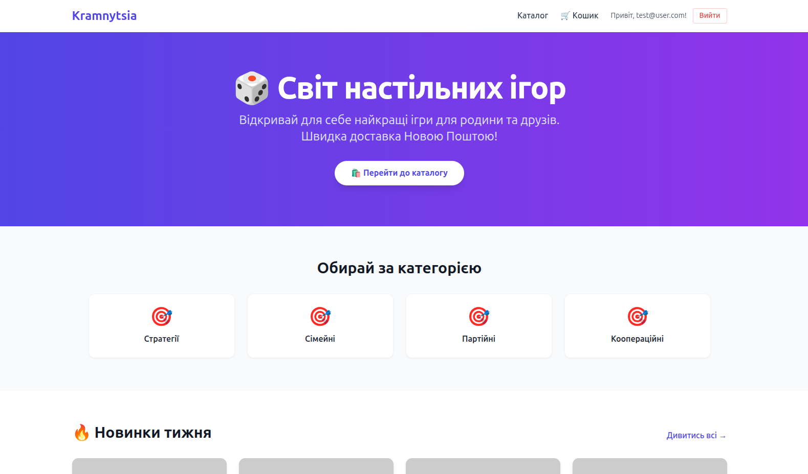
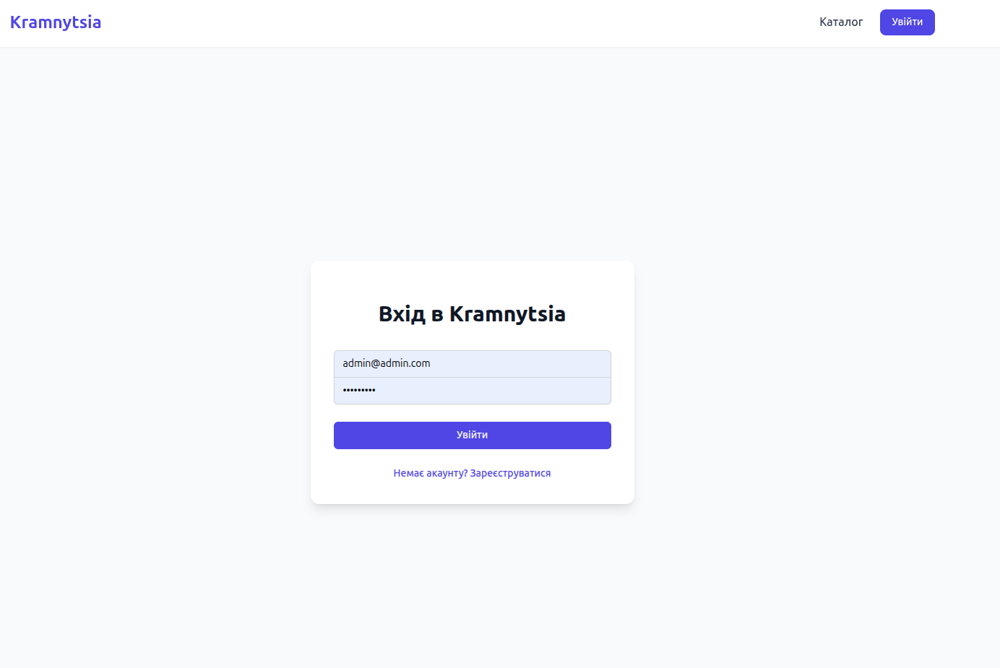
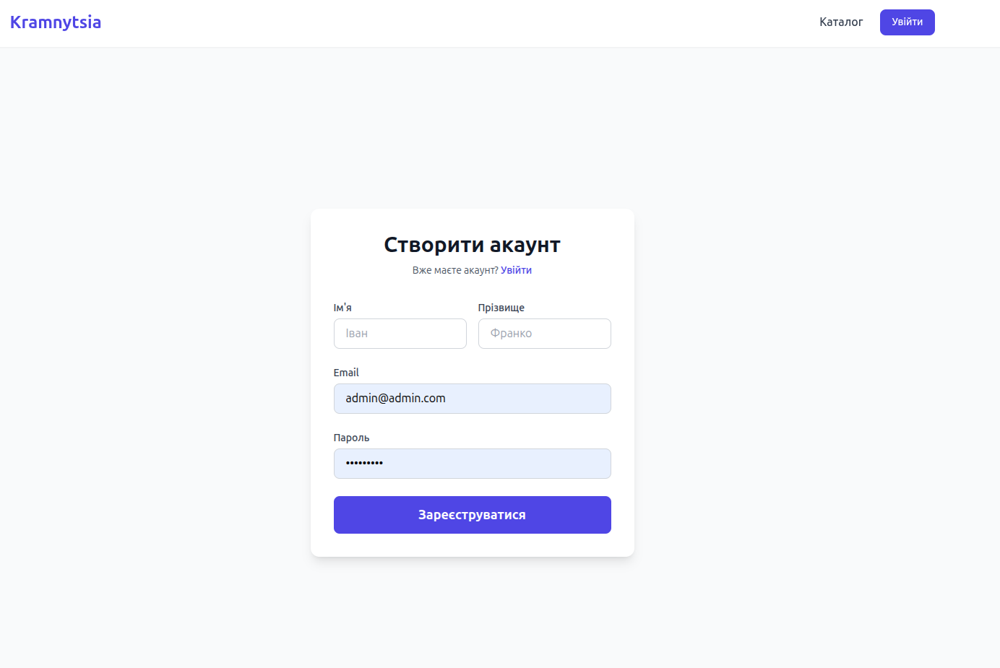
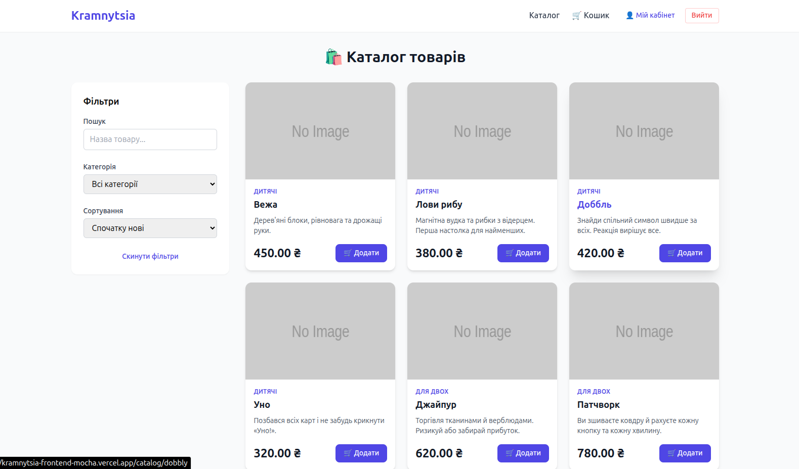
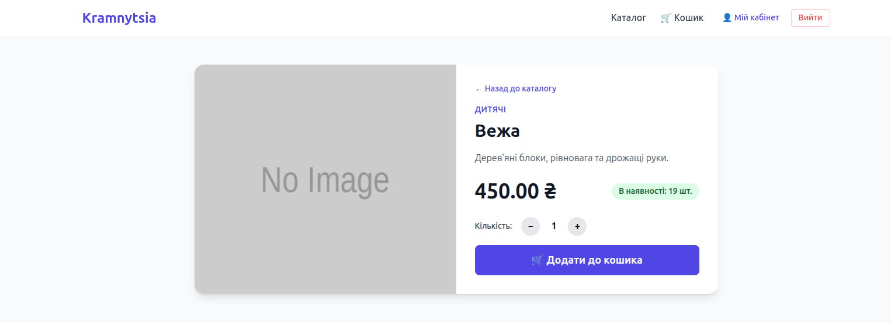
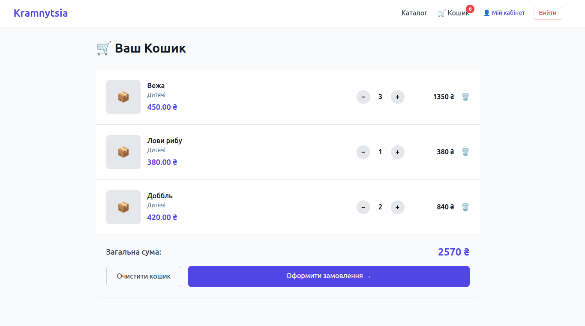
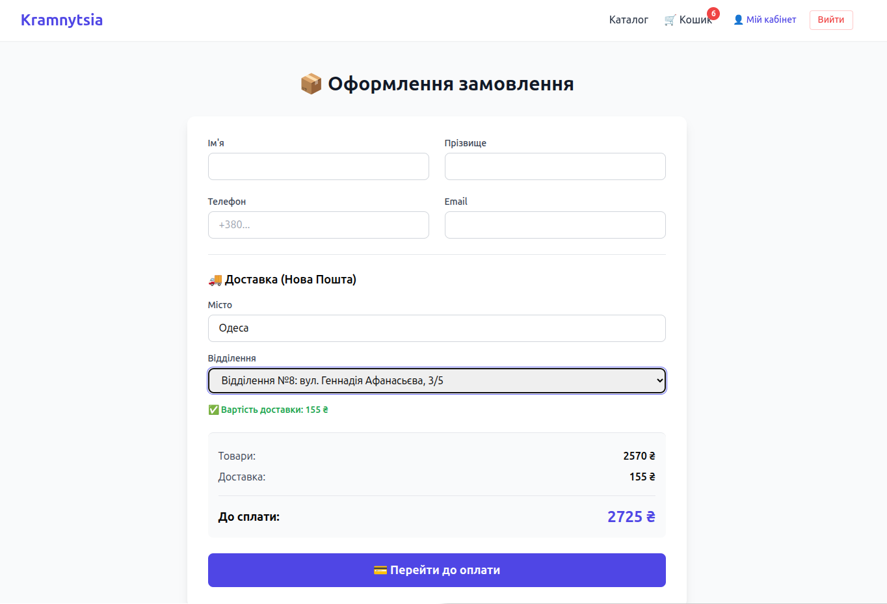
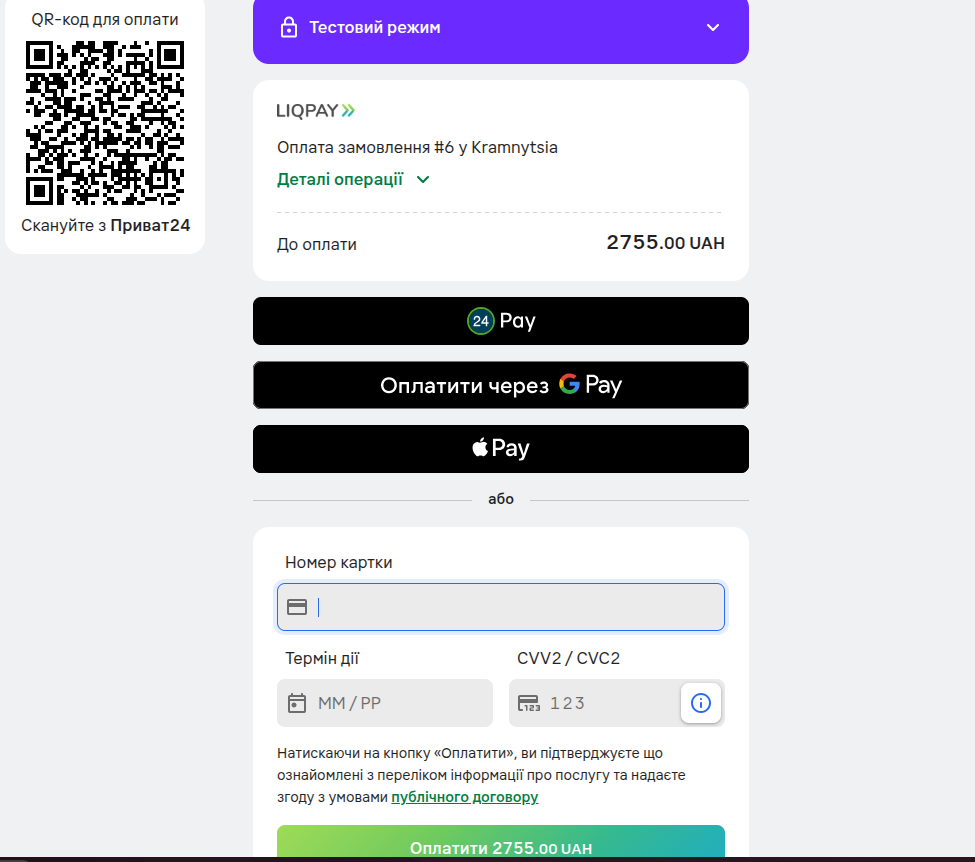
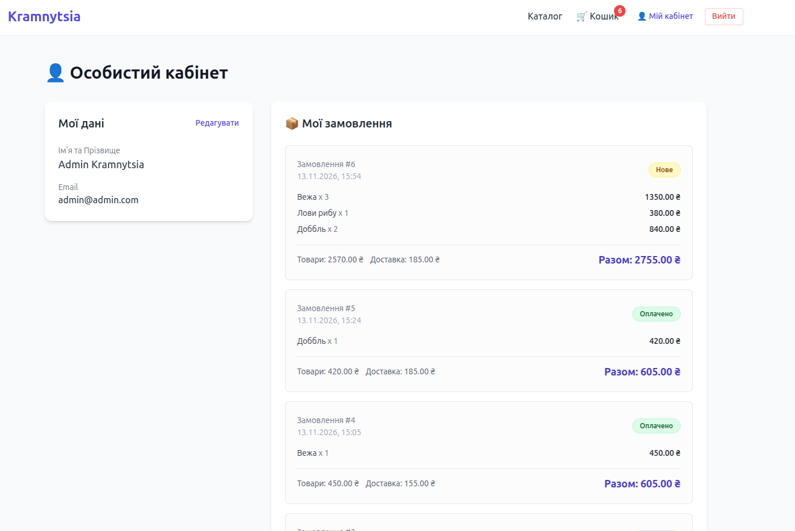

# 🛒 Kramnytsia Frontend

Сучасний, адаптивний клієнтський інтерфейс для інтернет-магазину настільних ігор "Kramnytsia". Проєкт побудований на **React + Vite** з використанням **Tailwind CSS** для стилізації та інтегрований з потужним Django REST API.

🔗 **Live Demo (Frontend):** [https://kramnytsia-frontend-mocha.vercel.app](https://kramnytsia-frontend-mocha.vercel.app)  
🔗 **Live Demo (Backend API):** [https://kramnytsia-backend.onrender.com/api/docs/](https://kramnytsia-backend.onrender.com/api/docs/)  
🔗 **Backend Repository:** [github.com/agridenko/kramnytsia-backend](https://github.com/agridenko/kramnytsia-backend)

---

## ✨ Основні можливості

- 🔐 **Автентифікація та авторизація**: Реєстрація, вхід, JWT-токени, захищені маршрути (`ProtectedRoute`).
- 📦 **Каталог товарів**: Пагінація, фільтрація за категоріями, сортування за ціною/назвою, пошук.
- 🛒 **Серверний кошик**: Синхронізація кошика з базою даних (товари не зникають після виходу з акаунта або зміни пристрою).
- 🚚 **Інтеграція з Новою Поштою**: Автоматичне завантаження міст, відділень та динамічний розрахунок вартості доставки.
- 💳 **Оплата через LiqPay**: Повний цикл оформлення замовлення з інтеграцією платіжного шлюзу (підтримка Sandbox та Mock-режиму для стабільного тестування).
- 👤 **Особистий кабінет**: Перегляд та редагування профілю, історія замовлень з пагінацією та детальним складом кожного замовлення.
- 📱 **Адаптивний дизайн**: Повна підтримка мобільних пристроїв, планшетів та десктопів завдяки Tailwind CSS.
- ⚡ **Оптимізація**: Швидке завантаження, обробка станів завантаження (loading states) та помилок.

---

## 🛠 Технологічний стек

- **Core**: React 18, Vite
- **Routing**: React Router DOM v6
- **State Management**: React Context API
- **Styling**: Tailwind CSS
- **HTTP Client**: Axios (з інтерцепторами для автоматичного додавання JWT-токенів)
- **Forms**: Нативні HTML5 форми з валідацією
- **Deployment**: Vercel (CI/CD)

---

## 🚀 Швидкий старт (Локальна розробка)

Щоб запустити проєкт локально, виконай наступні кроки:

### 1. Клонуй репозиторій
```bash
git clone https://github.com/agridenko/kramnytsia-frontend.git
cd kramnytsia-frontend
```
### 2. Встанови залежності
```bash
npm install
```
### 3. Налаштуй змінні оточення
Створи файл .env у корені проєкту та додай туди URL твого бекенду:
```env
VITE_API_URL=http://127.0.0.1:8000/api/v1
```
### 4. Запусти сервер розробки
```bash
npm run dev
```
Проєкт буде доступний за адресою: http://localhost:5173


## 📂 Структура проєкту
```text
src/
├── components/       # Багаторазові UI-компоненти (Header, Footer, ProductCard тощо)
├── context/          # Global state (AuthContext, CartContext)
├── pages/            # Основні сторінки (Home, Catalog, Cart, Checkout, Profile, Login, Register)
├── services/         # Налаштування Axios та API-запити
├── utils/            # Допоміжні функції (форматування дат, валют)
├── App.jsx           # Головний компонент та налаштування маршрутизації
└── main.jsx          # Точка входу додатку
```

## 📸 Скріншоти











## 🤝 Внесок у проєкт (Contributing)
1. Зробіть Fork репозиторію.
2. Створіть гілку для вашої фічі (git checkout -b feature/AmazingFeature).
3. Закомітьте зміни (git commit -m 'Add some AmazingFeature').
4. Зробіть Push у гілку (git push origin feature/AmazingFeature).
5. Відкрийте Pull Request.


## 👨‍💻 Автор
Олексій Гріденко

📧 **Email:** agridenko@gmail.com

💼 **LinkedIn:** [alexey-hridenko](https://www.linkedin.com/in/alexey-hridenko-243682165/)

💻 **GitHub:** [agridenko](https://github.com/agridenko)